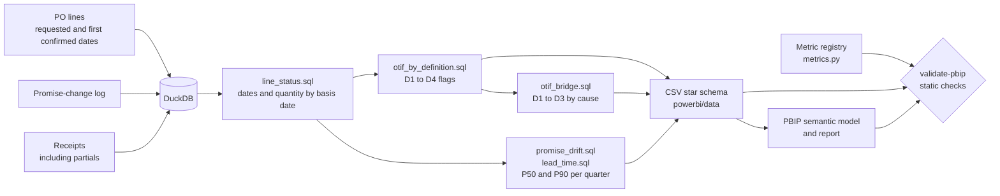

# promisedrift

[](https://github.com/SlateGitOrg/promisedrift/actions/workflows/ci.yml)


promisedrift scores supplier on-time-in-full (OTIF) four ways from the same PO lines and shows exactly how much of the gap between the ERP scorecard and the first-confirmed-date number comes from early arrivals, moved promise dates and partial shipments. The reference logic is DuckDB SQL with a metric registry and tests; the deliverable for buyers is a Power BI project (PBIP: TMDL semantic model plus PBIR-legacy report) over a CSV star schema, checked statically because Power BI cannot run in CI. All data is synthetic and generated from a seed.

## The problem

An automotive tier-1 interior-systems supplier (seats, door panels) feeds its assembly lines from about 35 tier-2 suppliers. Its ERP scorecard measures OTIF against the latest promise date. Suppliers update that date as soon as they know they will be late, so a supplier that re-promises every late line scores 95% while the line still waits. Early deliveries count as on time, and a partial shipment passes once the balance arrives. Buyers walk into quarterly business reviews with rankings that reward re-promising, and the discussion becomes which number to believe.

promisedrift computes OTIF under four explicit definitions and decomposes the gap between the headline (D1) and the first-confirmed number (D3) into components that add up exactly, so the review can talk about why a supplier's number moved.

| Definition | Line is OTIF when |
|---|---|
| D1 ERP headline | first receipt is on or before the latest promise, and at least 98% is eventually received |
| D2 latest promise | first receipt is within 3 days before to 0 days after the latest promise, and 98% is received by it |
| D3 first confirmed | the same window and quantity rule against the first confirmed date |
| D4 requested | the same window and quantity rule against the requested date |

## How it works



1. `generate` writes four raw CSV tables (suppliers, PO lines, promise changes, receipts) and a `truth.json` that lists what was injected.
2. `build` loads them into DuckDB and runs the SQL in `src/promisedrift/sql/` in order: `line_status` (requested date, first confirmed date, latest promise from the change log, first receipt, quantity received by each basis date), `otif_by_definition`, `otif_bridge`, `promise_drift` and `lead_time`.
3. `export` writes `dim_supplier`, `dim_date`, `fct_po_line_status` and `fct_lead_time` into `powerbi/data/`. The Power BI measures are plain sums over the exported flags, so the definitions live in one place, the SQL.
4. `validate-pbip` parses the TMDL tables, columns, measures and relationships and the report's visual bindings. It fails when a DAX reference or a visual binding is missing from the model or the CSV headers, when a relationship key is blank, duplicated on the one side or orphaned on the many side, when a CSV value does not parse as the declared type, or when the measure set differs from the registry in `metrics.py`. Each measure must also aggregate the column and use the form the registry names (for example `OTIF Headline %` is `DIVIDE ( SUM ( fct_po_line_status[d1_otif] ), COUNTROWS ( fct_po_line_status ) )`, whitespace aside), so a measure that sums the wrong flag fails.
5. `report` prints a Markdown scorecard with D1 and D3 ranks and each supplier's bridge.

### The bridge

For each line where D1 and D3 disagree, the line's `delta = D3 - D1` goes to the first cause that applies:

1. **Early arrival**: first receipt more than 3 days before the first confirmed date.
2. **Re-promise**: first receipt after the first confirmed date (the headline passes only because the promise moved). A pull-in, where the promise moved earlier and delivery came on the original date, flips the sign: D1 fails, D3 passes, and the line counts positive here.
3. **Partial shipment**: less than 98% received by the first confirmed date.
4. **Other**: a guard bucket. The rules above leave it empty, and it stays so that the components still sum if a definition changes.

Every non-zero delta lands in exactly one bucket, so the components sum to D3 - D1 exactly, overall and for each supplier. The tests check this with integer line counts.

## Quick start

Python 3.11 or newer.

```bash
python -m venv .venv && . .venv/bin/activate
pip install -e ".[dev]"

promisedrift generate --seed 7 --out data     # synthetic raw tables
promisedrift build                            # DuckDB reference tables in build/
promisedrift export                           # star-schema CSVs in powerbi/data/
promisedrift validate-pbip                    # static checks on the PBIP project
promisedrift report --top 10                  # Markdown scorecard
```

To open the report in Power BI Desktop, open `powerbi/PromiseDrift.pbip` and set the `DataFolder` parameter to the absolute path of `powerbi/data/` with a trailing slash. The placeholder value in `expressions.tmdl` is `C:\promisedrift\powerbi\data\`.

## Example output

`promisedrift generate --seed 7 --out data`, then `build`, `export`, `validate-pbip`:

```text
Wrote 35 suppliers, 9,000 po_lines, 2,488 promise_changes, 10,483 receipts to data/
Built build/promisedrift.duckdb with 9,000 PO lines
dim_supplier.csv  35 rows
dim_date.csv  608 rows
fct_po_line_status.csv  9,000 rows
fct_lead_time.csv  210 rows
OK: 4 tables, 39 columns, 9 measures, 4 relationships, 3 pages, 12 visuals
```

`promisedrift report --top 10` (the overall bridge, then the supplier ranking):

| Definition | Judged against | OTIF |
|---|---|---:|
| D1 ERP headline | latest promise, early counts as on time | 86.0% |
| D2 latest promise | latest promise, window -3/+0 days | 69.7% |
| D3 first confirmed | first confirmed date, window -3/+0 days | 70.9% |
| D4 requested | requested date, window -3/+0 days | 57.9% |

| Step | pp |
|---|---:|
| D1 headline | 86.0 |
| Early arrival | -1.0 |
| Re-promise | -3.8 |
| Partial shipment | -10.3 |
| Other | 0.0 |
| D3 first confirmed | 70.9 |

| Supplier | Commodity | Lines | D1 | D1 rank | D3 | D3 rank | D1 - D3 pp | Early pp | Re-promise pp | Partial pp |
|---|---|---:|---:|---:|---:|---:|---:|---:|---:|---:|
| SUP-28 Cobalt Metal Stampings | stampings | 330 | 98.8% | 1 | 51.8% | 32 | 47.0 | 0.0 | -43.0 | -3.9 |
| SUP-19 Stanmore Textiles | fabric | 279 | 96.1% | 2 | 51.3% | 33 | 44.8 | 0.0 | -43.0 | -1.8 |
| SUP-07 Garnet Fasteners | fasteners | 173 | 96.0% | 3 | 55.5% | 31 | 40.5 | 0.0 | -39.9 | -0.6 |
| SUP-29 Denholm Metal Stampings | stampings | 280 | 91.1% | 4 | 81.1% | 3 | 10.0 | 0.0 | +1.4 | -11.4 |
| SUP-14 Northgate Textiles | fabric | 249 | 90.4% | 5 | 83.9% | 1 | 6.4 | 0.0 | +2.4 | -8.8 |
| SUP-22 Vantage Foam Products | foam | 200 | 90.0% | 6 | 77.5% | 6 | 12.5 | 0.0 | -2.5 | -10.0 |
| SUP-12 Larchmont Fasteners | fasteners | 220 | 89.5% | 7 | 50.5% | 34 | 39.1 | 0.0 | 0.0 | -39.1 |
| SUP-03 Calloway Polymers | resin | 306 | 89.2% | 8 | 81.0% | 4 | 8.2 | 0.0 | +0.3 | -8.5 |
| SUP-24 Yarrow Foam Products | foam | 180 | 88.9% | 9 | 77.8% | 5 | 11.1 | 0.0 | +0.6 | -11.7 |
| SUP-23 Westerly Foam Products | foam | 278 | 88.1% | 10 | 48.2% | 35 | 39.9 | -32.0 | -0.7 | -7.2 |

The three suppliers that re-promise late lines (SUP-28, SUP-19, SUP-07) rank 1 to 3 on the headline and 31 to 33 of 35 on the first-confirmed date, and 90% or more of their bridge is re-promise. SUP-12's gap is almost all partial shipment (it ships 85 to 92% on the date and the balance 6 to 10 days later on 40% of lines). SUP-23's is early arrival.

Actual lead time (order to first receipt) against the quoted lead time for resin supplier SUP-03, from the `lead_time_quarter` table:

| Order quarter | Lines | Quoted days | Actual P50 | Actual P90 |
|---|---:|---:|---:|---:|
| 2024-Q3 | 61 | 14 | 14.0 | 16.0 |
| 2024-Q4 | 53 | 14 | 14.0 | 14.8 |
| 2025-Q1 | 35 | 14 | 14.0 | 14.0 |
| 2025-Q2 | 54 | 14 | 28.0 | 30.0 |
| 2025-Q3 | 48 | 14 | 28.0 | 29.0 |
| 2025-Q4 | 55 | 14 | 28.0 | 28.0 |

## Design decisions

- **Timing is judged on the first receipt, quantity on a cumulative count at the basis date.** A line is on time if its first receipt is not more than 3 days early and 98% of the quantity is in by the basis date. A line whose first receipt comes 4 or more days early is therefore counted early even if the balance arrives on the date, which is stricter than judging the last receipt. The alternative, scoring each receipt separately, would need a rule for splitting a line's score across receipts and would make line counts disagree with the ERP's.
- **The window is -3/+0 days, asymmetric on purpose.** Late is always a miss, and early beyond 3 days is a miss because lineside storage for seats and door panels is small. The 3 days and the 98% threshold are literals in `sql/macros.sql`, in integer arithmetic (`received * 100 >= 98 * ordered`), so a line at exactly 98% passes and 97.9% does not. Changing either number is a one-line edit, but the committed CSVs and the numbers in this README would then need regenerating.
- **The bridge attributes each line to one cause in a fixed order.** Taking the first applicable cause makes the components additive without an interaction term. The price is that the order matters: a line that is both early and re-promised is counted as early. The order puts the cause that is visible on the receipt (early) before the one that depends on the promise log.
- **The metric logic is in SQL and the Power BI measures are thin.** `fct_po_line_status` carries the D1 to D4 flags and bridge columns, and each measure is a `DIVIDE` of a `SUM` over a flag. The tested SQL is the source of truth and the DAX has little room to disagree with it. The cost is that Power BI does not recompute definitions from dates, so changing the window means re-running `export`, not editing a measure. `Lead Time P90 Days` returns the worst quarter when more than one quarter is in scope, because percentiles do not average.
- **The PBIP project is checked statically and has not been opened in Power BI Desktop.** `validate-pbip` proves that references resolve, types and keys hold, the measure set matches the registry and each measure has the registry's aggregation form over the registry's column. It does not evaluate DAX, so a syntax error inside a measure would only show up on open. The measures are kept to `DIVIDE`, `SUM`, `COUNTROWS`, `AVERAGE` and `MAX` to keep that risk small.
- **Resin supplier SUP-03 confirms its longer lead time.** From April 2025 it needs about 28 days against a quoted 14 and confirms a date to match, so it still scores well against its own confirmation (D3) while D4 and the lead-time view show the step. This is deliberate: D3 measures reliability to a commitment, not whether the commitment is reasonable, and the requested-date definition and lead-time percentiles exist for the second question.

## Testing

```bash
pytest -q
```

91 tests, offline and about four seconds. They cover:

- the 10-line fixture (D1 90%, D2 70%, D3 50%, D4 40%; bridge early -10 pp, re-promise -20 pp, partial -10 pp), window and 98% boundaries, pull-ins, lines with no receipt and cause precedence;
- the bridge identity on integer counts, overall and for every supplier;
- recovery of the injected behaviours in the seeded data, repeated on two further seeds for the ranking claims;
- the generator (determinism, volumes, promise-log chain, receipts never exceeding the order);
- the SQL reference on small known inputs and the metric registry;
- the export (headers equal the schema, keys unique, the committed `powerbi/data` equals a fresh export);
- the TMDL and DAX parsers and `validate-pbip`, both on the committed project and on copies broken on purpose: a measure pointing at a missing column, a deleted or extra measure, a renamed CSV column, a duplicated key, a mistyped value, a visual bound to a missing column and a bad model path.

CI runs `ruff check`, `ruff format --check` and `pytest` on Python 3.12 and 3.13.

## Project layout

```text
src/promisedrift/
  cli.py          typer commands: generate, build, export, validate-pbip, report
  generator.py    seeded synthetic data and the injected supplier behaviours
  engine.py       load raw CSVs into DuckDB and run the SQL files in order
  sql/            macros, line_status, otif_by_definition, otif_bridge, lead_time, promise_drift
  metrics.py      registry: name, grain, unit and SQL for the nine reference metrics
  analysis.py     scorecard, overall OTIF and bridge counts
  report.py       Markdown scorecard
  schema.py       star-schema tables, column order and types
  export.py       DuckDB tables to CSV star schema
  tmdl.py         TMDL parser (tables, columns, measures, partitions, relationships)
  dax.py          DAX reference extraction
  pbip.py         validate-pbip checks
powerbi/
  PromiseDrift.pbip
  PromiseDrift.SemanticModel/   definition.pbism, definition/ (database, model, expressions,
                                relationships, tables/*.tmdl)
  PromiseDrift.Report/          definition.pbir, report.json (Scorecard, OTIF Bridge, Supplier Drill)
  data/                         exported star-schema CSVs
tests/
.github/workflows/ci.yml
```

## License

MIT. See `LICENSE`.
